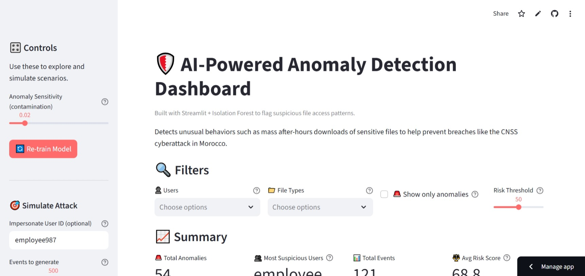

# AI Security Guard 🛡️🤖

In April 2025, Morocco’s CNSS (National Social Security Fund) suffered a major cyberattack where sensitive data of millions of citizens was leaked and shared on platforms like Telegram. This incident highlighted a critical gap: traditional security tools like firewalls and patching are not always enough to stop attackers once they find a way in.

**AI Security Guard** is a proof-of-concept project that shows how AI can add an extra layer of defense. Instead of blocking attacks directly, it focuses on detecting suspicious behaviors inside the system—like unusual data downloads at strange hours or a user suddenly exporting thousands of records.

The project uses machine learning (Isolation Forest) to learn what “normal” activity looks like, then flags anything that seems out of place. A simple dashboard makes it easy for security teams to:

- Visualize suspicious events
- Simulate attack scenarios (like mass downloads or impersonation)
- Filter results by risk score to focus on the most dangerous activities

While no system is perfect, this tool demonstrates how AI can support security teams by catching attacks faster and giving them a chance to react before too much damage is done.

— Built with Python, Streamlit, scikit-learn, and Plotly.

## ✨ Key Features

- Behavioral anomaly detection with Isolation Forest
- Risk scoring (0–100) and high-risk alerts
- Interactive visuals: downloads by hour, size distribution, risk histogram, heatmaps, timeline
- Advanced filters by user, file type, and risk threshold
- One-click data export and attack simulation for demos

### ML Highlights
- Unsupervised detection (Isolation Forest)
- Time- and behavior-based feature engineering
- Model persistence (load/save) and retraining controls

## 🚀 Quick Start

1) Install
```bash
pip install -r requirements.txt
```

2) Run
```bash
python -m streamlit run src/main.py
```

3) Optional: Tests
```bash
python tests/test_app.py
```

## 🔗 Links

- GitHub repository: `https://github.com/ARWA044/AI-security-guard`
- Live demo (Streamlit Cloud): `https://ai-security-guard.streamlit.app/` (availability not verified)

## ℹ️ Project Status

This project is under active development. It currently uses simulated/random data and does not yet support uploading or testing with your own datasets. Custom data ingestion is planned for a future release.

## 🖼️ Screenshot / Demo



## ⚙️ Configuration (Summary)

Edit `src/config.py` to adjust:
- Contamination rate, estimators, sampling
- Working hours and file types
- Paths for data, logs, and models

<details>
<summary>How it works (technical)</summary>

1. Load or simulate access logs and validate data
2. Engineer behavioral features (e.g., hour-of-day, activity frequency, file sizes)
3. Score with Isolation Forest → normalize to risk score (0–100)
4. Surface high-risk events with alerts and visuals for triage

</details>

## 🔒 Note

This is a complementary detection layer focused on behavior inside the perimeter. It does not replace patching, identity controls, EDR, or SIEM/SOAR.


## Evaluation limitations

Risk scores are relative anomaly scores, not calibrated attack probabilities. Synthetic data does not establish production detection accuracy; retraining on simulated suspicious events can change the baseline.
